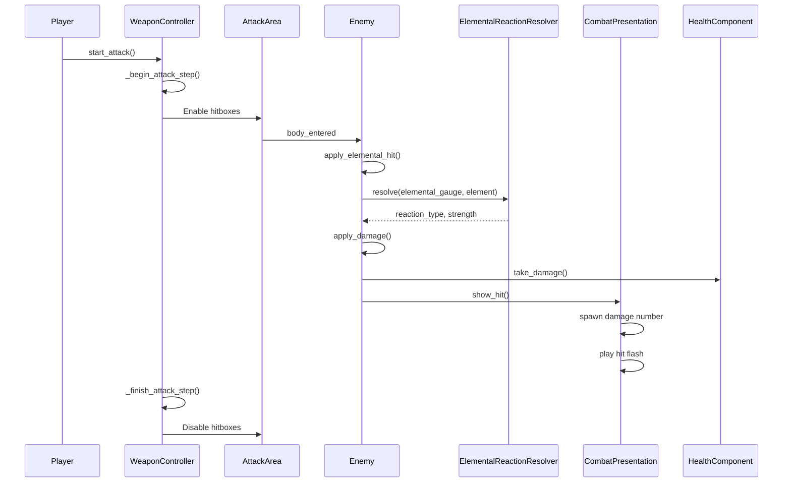
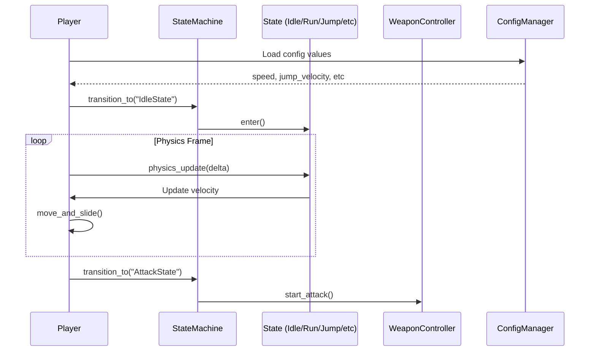
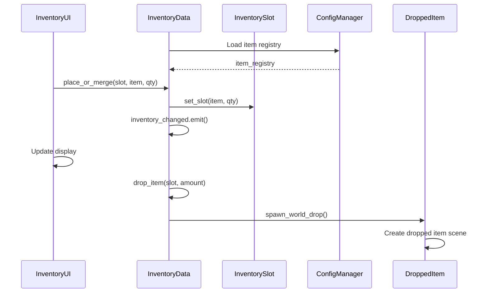
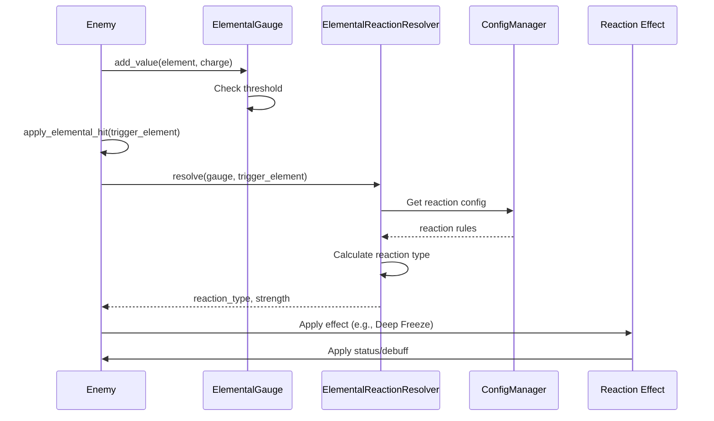

# The Core Element - Architecture Diagram

## Overview
This is a Godot 4.7 2D action game featuring elemental combat, weapon systems, inventory management, and complex enemy AI with elemental reactions.

## System Architecture

```mermaid
graph TB
    subgraph "Main Scene"
        MainNode[MainNode]
        World[World]
        CanvasLayer[CanvasLayer]
        MainNode --> World
        MainNode --> CanvasLayer
    end

    subgraph "World"
        Environment[Environment]
        Actors[Actors]
        Interactables[Interactables]
        Effects[Effects]
        World --> Environment
        World --> Actors
        World --> Interactables
        World --> Effects
    end

    subgraph "Actors"
        Player[Player]
        Enemies[Enemies]
        Actors --> Player
        Actors --> Enemies
    end

    subgraph "Player System"
        PlayerMovement[PlayerMovement<br/>CharacterBody2D]
        StateMachine[StateMachine]
        WeaponController[WeaponController]
        InventoryData[InventoryData]
        HealthComponent[HealthComponent]
        StatusEffectManager[StatusEffectManager]

        Player --> PlayerMovement
        Player --> StateMachine
        Player --> WeaponController
        Player --> InventoryData
        Player --> HealthComponent
        Player --> StatusEffectManager
    end

    subgraph "Player States"
        IdleState[IdleState]
        RunState[RunState]
        JumpState[JumpState]
        RollState[RollState]
        LandingRollState[LandingRollState]
        AttackState[AttackState]
        DeathState[DeathState]

        StateMachine --> IdleState
        StateMachine --> RunState
        StateMachine --> JumpState
        StateMachine --> RollState
        StateMachine --> LandingRollState
        StateMachine --> AttackState
        StateMachine --> DeathState
    end

    subgraph "Combat System"
        WeaponData[WeaponData]
        AttackDefinition[AttackDefinition]
        WeaponRuntime[WeaponRuntime]
        DamageContext[DamageContext]
        ElementalGauge[ElementalGauge]
        ElementalReactionResolver[ElementalReactionResolver]
        CombatPresentation[CombatPresentation]

        WeaponController --> WeaponData
        WeaponController --> AttackDefinition
        WeaponController --> WeaponRuntime
        WeaponController --> DamageContext
        CombatPresentation --> DamageContext
    end

    subgraph "Enemy System"
        EnemyBase[EnemyBase<br/>CharacterBody2D]
        EnemyStateMachine[EnemyStateMachine]
        EnemyState[EnemyState]
        EnemyDefinition[EnemyDefinition]
        EnemyDamageResolver[EnemyDamageResolver]
        EnemyElementalGauge[ElementalGauge]
        EnemyReactionResolver[ElementalReactionResolver]

        Enemies --> EnemyBase
        EnemyBase --> EnemyStateMachine
        EnemyBase --> EnemyState
        EnemyBase --> EnemyDefinition
        EnemyBase --> EnemyDamageResolver
        EnemyBase --> EnemyElementalGauge
        EnemyBase --> EnemyReactionResolver
    end

    subgraph "Inventory System"
        InventorySlot[InventorySlot]
        ItemData[ItemData]
        DroppedItem[DroppedItem]
        InventoryUI[InventoryUI]

        InventoryData --> InventorySlot
        InventoryData --> ItemData
        InventoryData --> DroppedItem
        CanvasLayer --> InventoryUI
        InventoryUI --> InventoryData
    end

    subgraph "UI System"
        PlayerHUD[PlayerHUD]
        HPMainBar[HPMainBar]
        DamageNumber[DamageNumber]

        CanvasLayer --> PlayerHUD
        PlayerHUD --> HPMainBar
        CombatPresentation --> DamageNumber
    end

    subgraph "Configuration System"
        ConfigManager[ConfigManager<br/>Autoload Singleton]
        PlayerConfig[player.json]
        WeaponsConfig[weapons.json]
        EntitiesConfig[entities.json]
        ItemsConfig[items.json]
        PhysicsConfig[physics.json]
        UIEffectsConfig[ui_effects.json]
        ElementalReactionsConfig[elemental_reactions.json]

        ConfigManager --> PlayerConfig
        ConfigManager --> WeaponsConfig
        ConfigManager --> EntitiesConfig
        ConfigManager --> ItemsConfig
        ConfigManager --> PhysicsConfig
        ConfigManager --> UIEffectsConfig
        ConfigManager --> ElementalReactionsConfig
    end

    subgraph "Elemental Reactions"
        ThermoBurst[Thermo Burst<br/>Fire + Ice]
        MagneticOverload[Magnetic Overload<br/>Electric + Ice]
        PlasmaDischarge[Plasma Discharge<br/>Electric + Electric]
        EtherDetonation[Ether Detonation<br/>Ether + Ether]
        DeepFreeze[Deep Freeze<br/>Ice + Ice]
        Hemorrhage[Hemorrhage<br/>Ether + Ice]

        ElementalReactionResolver --> ThermoBurst
        ElementalReactionResolver --> MagneticOverload
        ElementalReactionResolver --> PlasmaDischarge
        ElementalReactionResolver --> EtherDetonation
        ElementalReactionResolver --> DeepFreeze
        ElementalReactionResolver --> Hemorrhage
    end

    ConfigManager -.-> PlayerMovement
    ConfigManager -.-> WeaponController
    ConfigManager -.-> EnemyBase
    ConfigManager -.-> InventoryData
    ConfigManager -.-> CombatPresentation
    ConfigManager -.-> ElementalReactionResolver

    WeaponController -.-> CombatPresentation
    EnemyBase -.-> CombatPresentation
```

## Data Flow Diagrams

### Combat Flow

### Player Movement Flow

### Inventory Flow

### Elemental Reaction Flow

## Component Relationships

### ConfigManager (Autoload Singleton)
- Loads all JSON configs from `res://Configs/`
- Provides typed accessors: `get_float()`, `get_int()`, `get_bool()`, `get_string()`, `get_array()`, `get_dict()`
- Supports dot-notation paths: `"player.movement.speed"`
- Used by: Player, WeaponController, EnemyBase, InventoryData, CombatPresentation, ElementalReactionResolver

### Player (CharacterBody2D)
- Movement: Speed, acceleration, friction, coyote time, jump buffer
- States: Idle, Run, Jump, Roll, LandingRoll, Attack, Death
- Combat: WeaponController, HealthComponent, StatusEffectManager
- Inventory: InventoryData with equipment slots
- Visuals: Squash/stretch animations, hit stop

### WeaponController
- Manages weapon equipment and attack execution
- Combo system with timing
- Hitbox activation/deactivation based on attack timing
- Knockback calculation based on weapon weight
- Applies elemental charge to enemies

### EnemyBase (CharacterBody2D)
- AI state machine (Idle, Attack, Dead)
- Elemental reaction system
- Status effects: Deep Freeze, Stun, Magnetic Overload, Plasma Discharge, Ether Detonation
- Damage resistance calculation
- Weight-based knockback

### ElementalReactionResolver
- Resolves elemental combinations into reactions
- Reaction types:
  - Thermo Burst (Fire + Ice): AOE fire damage + resistance reduction
  - Magnetic Overload (Electric + Ice): Attracts enemies, then explodes
  - Plasma Discharge (Electric + Electric): Repeated electric damage + stun
  - Ether Detonation (Ether + Ether): Delayed explosion + shockwave
  - Deep Freeze (Ice + Ice): Freeze + damage accumulation + shatter
  - Hemorrhage (Ether + Ice): Pure damage based on max health
- Strength decay on repeated reactions

### InventoryData
- 48 inventory slots
- Equipment: Primary/Backup weapons, 7 accessories, 2 accessory stones, 2 consumables
- Item registry loaded from config
- Operations: add, remove, swap, drop, use
- Spawns dropped items in world

### CombatPresentation (Autoload Singleton)
- Visual feedback for combat
- Damage number spawning
- Hit flash effect (shader-based)
- Configurable duration and color

## Key Design Patterns

1. **State Machine Pattern**: Player and Enemy both use state machines for behavior
2. **Component Pattern**: HealthComponent, StatusEffectManager, WeaponController as separate components
3. **Singleton Pattern**: ConfigManager and CombatPresentation as autoload singletons
4. **Data-Driven Design**: JSON configs drive gameplay values
5. **Observer Pattern**: Signals for inventory changes, equipment changes, deaths
6. **Factory Pattern**: ItemData.from_config(), WeaponRuntime creation

## Configuration Files

- `player.json`: Movement stats, health, combat weight, visuals
- `weapons.json`: Weapon definitions, attack data, hitboxes
- `entities.json`: Enemy definitions, stats, attack patterns
- `items.json`: Item registry (weapons, accessories, consumables, stones)
- `physics.json`: Gravity, max fall speed
- `ui_effects.json`: Hit flash duration/color
- `elemental_reactions.json`: Reaction rules, thresholds, effect configurations

## Physics Layers

- Layer 1: World
- Layer 2: Player
- Layer 3: Enemies

## Input Actions

- `ui_left`, `ui_right`, `ui_up`, `ui_down`: Movement
- `Normal_Attack`: Left mouse button (attack)
- `dash`: Shift key (dash)
- `toggle_inventory`: Tab or I (inventory)
- `interact`: E key (interact)
